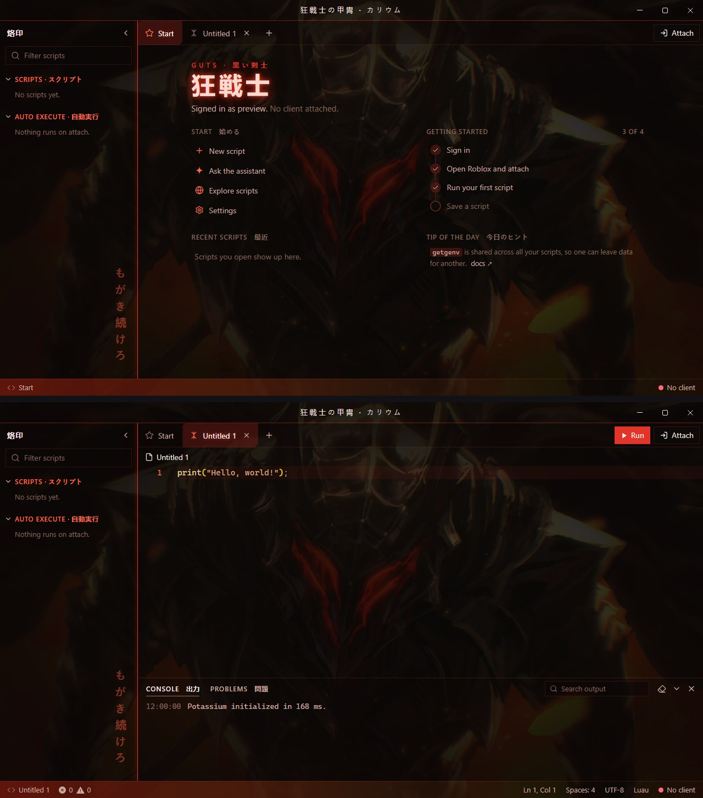
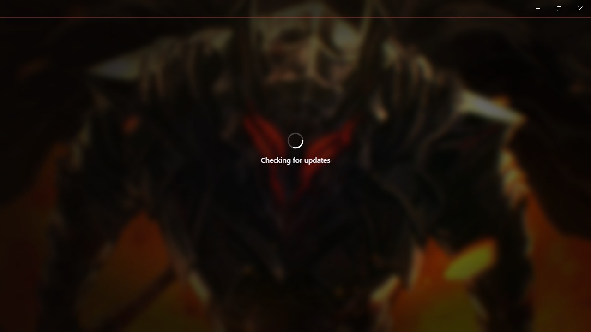
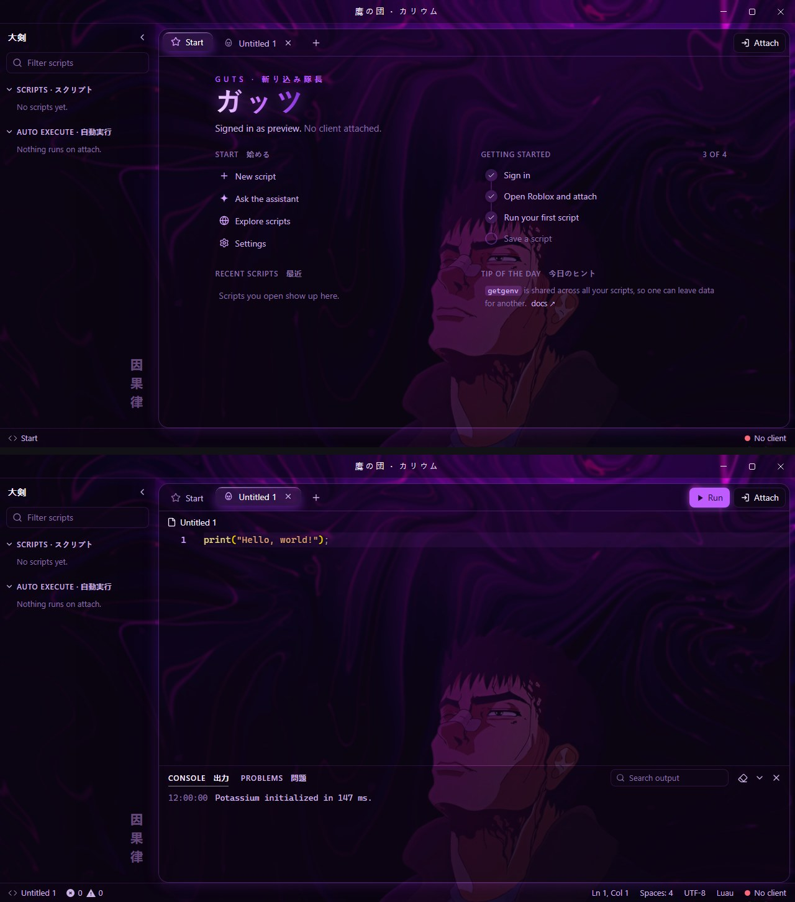
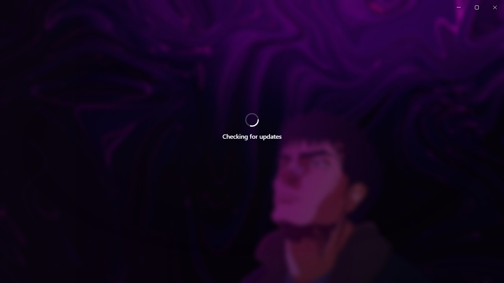
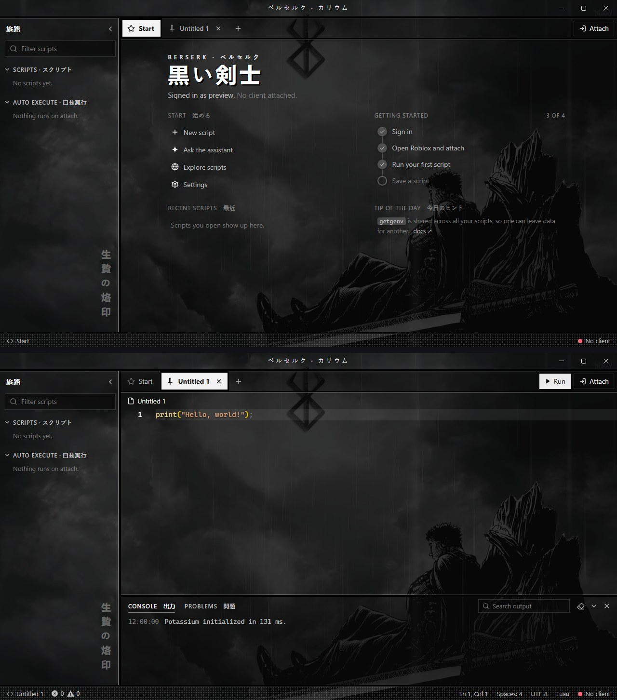
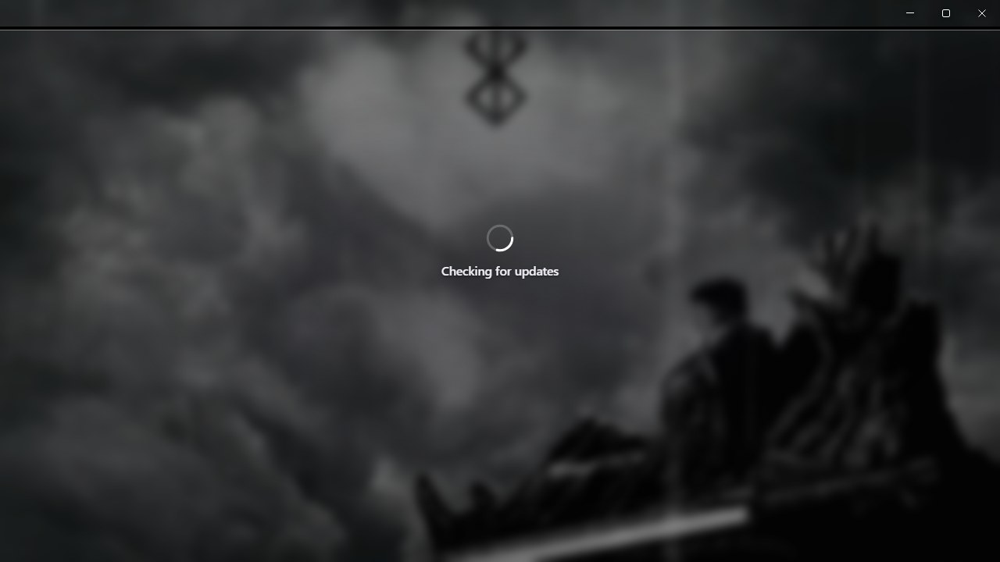

# Berserk themes for Potassium

Three animated Berserk themes for the Potassium executor. Each one has its own colour palette, its own layout and its own Japanese labels, with a looping wallpaper playing behind the whole app.

| Theme | Base theme | Look |
|---|---|---|
| [Guts · Berserker Armor](#guts--berserker-armor) | Dark | Black iron and ember red, jagged tabs, glowing blood-red seam |
| [Guts · Abstract Purple](#guts--abstract-purple) | Dark | Liquid violet glass, rounded panels, glowing edges, gradient heading |
| [Guts · Chilling in the Rain](#guts--chilling-in-the-rain) | Dark | Monochrome manga page, heavy black panel frames, screentone status bar |

Previews are animated (AVIF) and show the Start page, a script tab and the loading screen at full size. Browsers that can't play AVIF show a still screenshot instead.

## Install

1. In Potassium, open **Settings → Appearance → Custom theme**.
2. Set **Base theme** to the one listed for that theme (Dark or **Light**). The editor's syntax colours come from the base theme.
3. Open the theme's folder, copy everything in its `Theme.css` and paste it into **Custom CSS**.
4. Type a name under **Save** and click **Save**.

## Loading screen

Every theme also replaces Potassium's own loading and login picture with its wallpaper, softly blurred, so the theme starts the moment the app opens. Each theme's loading screen is shown under its preview.

## Labels in every theme

| Text | Reading | Meaning |
|---|---|---|
| カリウム | karyūmu | Potassium |
| スクリプト | sukuriputo | Scripts |
| 自動実行 | jidō jikkō | Auto execute |
| 出力 | shutsuryoku | Output (console) |
| 問題 | mondai | Problems |
| 始める | hajimeru | Start |
| 最近 | saikin | Recent |
| 今日のヒント | kyō no hinto | Tip of the day |

Each theme below also has its own text; open **What the Japanese means** under its preview.

## Guts · Berserker Armor

<picture>
  <source srcset="guts-armor/ui.avif" type="image/avif">
  
</picture>

<picture>
  <source srcset="guts-armor/loading.avif" type="image/avif">
  
</picture>

[`Theme.css`](guts-armor/Theme.css) · Base: Dark · 狂戦士の甲冑 · 烙印 · もがき続けろ

What the Japanese means

| Text | Reading | Meaning |
|---|---|---|
| 狂戦士の甲冑 | kyōsenshi no kacchū | The Berserker Armor (title bar) |
| 烙印 | rakuin | The Brand (explorer) |
| 黒い剣士 | kuroi kenshi | The Black Swordsman |
| 狂戦士 | kyōsenshi | Berserker |
| もがき続けろ | mogaki tsuzukero | Keep struggling |

## Guts · Abstract Purple

<picture>
  <source srcset="guts-purple/ui.avif" type="image/avif">
  
</picture>

<picture>
  <source srcset="guts-purple/loading.avif" type="image/avif">
  
</picture>

[`Theme.css`](guts-purple/Theme.css) · Base: Dark · 鷹の団 · 大剣 · 因果律

What the Japanese means

| Text | Reading | Meaning |
|---|---|---|
| 鷹の団 | Taka no Dan | The Band of the Hawk (title bar) |
| 大剣 | taiken | Greatsword (explorer) |
| 斬り込み隊長 | kirikomi taichō | Raiders captain, his rank in the Band of the Hawk |
| ガッツ | Gattsu | Guts |
| 因果律 | ingaritsu | The law of causality |

## Guts · Chilling in the Rain

<picture>
  <source srcset="guts-rain/ui.avif" type="image/avif">
  
</picture>

<picture>
  <source srcset="guts-rain/loading.avif" type="image/avif">
  
</picture>

[`Theme.css`](guts-rain/Theme.css) · Base: Dark · ベルセルク · 旅路 · 生贄の烙印

What the Japanese means

| Text | Reading | Meaning |
|---|---|---|
| ベルセルク | Beruseruku | Berserk (title bar) |
| 旅路 | tabiji | The journey (explorer) |
| 黒い剣士 | kuroi kenshi | The Black Swordsman |
| 生贄の烙印 | ikenie no rakuin | The Brand of Sacrifice |

## Notes

- Wallpapers are animated AVIF files loaded from this repo, so you need internet the first time. If a wallpaper can't load, the colours still apply.
- Potassium cuts custom CSS off at 50,000 characters. Each theme is about 6,500, so there's room for your own tweaks.
- The layouts target Potassium's internal class names. A future Potassium update could rename them; if that happens, the colours keep working but some layout touches may not.

## Credits

Berserk and its characters belong to Kentaro Miura, Studio Gaga and Hakusensha. The wallpapers are converted from live wallpapers posted on [WallpaperWaifu](https://wallpaperwaifu.com):
[Guts in Armor](https://wallpaperwaifu.com/anime/guts-in-armor-live-wallpaper-2718/),
[Guts Abstract Purple](https://wallpaperwaifu.com/anime/guts-abstract-purple-berserk-live-wallpaper-2539/),
[Guts Chilling in Rain](https://wallpaperwaifu.com/anime/guts-chilling-in-rain-berserk-monochrome-live-wallpaper-2520/).
